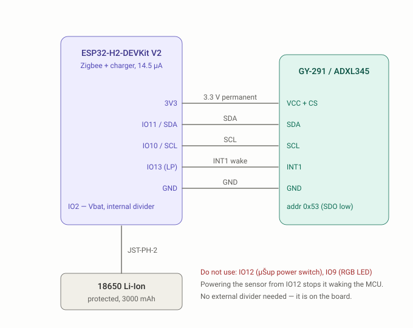
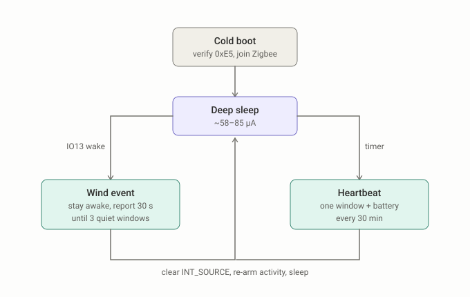

# Awning Wind Protection Sensor — Project Specification

A battery-powered Zigbee sensor that detects **awning movement** (not wind speed) and reports it
to Home Assistant so the awning can be retracted automatically before it gets damaged.

This is a functional replacement for the Somfy Eolis 3D, which also measures awning movement
rather than wind speed. Measuring movement is better than measuring wind because it reflects the
actual load on *this* awning in *this* wind shadow.

**Controller:** LaskaKit ESP32-H2-DEVKit V2 (`ESP32-H2-MINI-1-N4`, PCB antenna variant)
**Accelerometer:** GY-291 breakout, Analog Devices ADXL345, I2C mode
**Coordinator:** ConBee II, via Zigbee2MQTT (preferred) or ZHA
**Toolchain:** Arduino C++, arduino-esp32 core >= 3.1.0, Zigbee end-device mode

Board documentation and schematics: https://github.com/LaskaKit/ESP32-H2-DEVKit

---

## 1. Design goals and non-goals

### Goals
- Detect sustained awning movement above a configurable threshold, report it within ~30 s.
- Report a **numeric movement intensity** rather than a binary alarm. The threshold lives in
  Home Assistant so it can be tuned from a phone without reflashing or climbing a ladder.
- Report battery state of charge so HA can alert at 20% for manual USB-C recharge.
- Survive one full season (roughly April-October) on a single charge.
- Fail loudly: a dead or disconnected sensor must be distinguishable from calm weather.

### Non-goals
- No wind speed measurement, no anemometer, no wind direction.
- No solar charging. The sensor is removed and stored indoors over winter.
- No local retract decision. The device reports; Home Assistant decides and acts.
- No Wi-Fi. The ESP32-H2 has none, and this project never needed it.

### Known limitation (accept, do not try to solve in firmware)
A rolled-up awning does not move, so this sensor **cannot warn you not to extend** into wind that
is already blowing. It only guards the retract direction. Pair it with a weather-forecast
condition in HA for the extend direction.

---

## 2. Bill of materials

### Core electronics

| # | Part | Qty | Notes |
|---|---|---|---|
| 1 | LaskaKit ESP32-H2-DEVKit V2, PCB antenna | 1 | `LA100130P`. MCU + Zigbee + Li-Ion charger + onboard battery divider |
| 2 | GY-291 breakout (ADXL345, I2C/SPI) | 1 | 3-axis accelerometer with programmable activity interrupt |
| 3 | Protected 18650 Li-Ion cell, 3000-3500 mAh | 1 | **Protection PCB is mandatory** — see §8.3 |
| 4 | 18650 holder with leads | 1 | Do not solder directly to the cell |
| 5 | JST-PH 2.0 2-pin pigtail | 1 | Battery to the board's `JST-PH-2` connector |
| 6 | IP65/IP66 ABS enclosure, min. 100 x 60 x 35 mm | 1 | Board is 65.5 mm long. Light coloured, **not** black — see §8.2 |
| 7 | Aluminium L-bracket + M4 bolts/nuts | 1 set | Rigid mount to the front bar |
| 8 | Silicone wire 26-28 AWG, heatshrink | — | Five wires from board header to sensor |

### Not required — deliberately deleted from earlier revisions
- **No 200 kOhm resistors, no 2N7000, no 100 kOhm.** The DevKit has a battery voltage divider
  already fitted, on `IO2`. This replaced an entire discrete sub-circuit.
- **No TP4056 or other charger module.** The DevKit charges one Li-Ion cell over USB-C.
- **No LDO or buck converter.** The DevKit regulates from the cell.
- **No level shifters.** Everything is 3.3 V logic.
- **No decoupling caps**, unless inspection shows the GY-291 lacks them (most have them fitted).
- **No solar panel.** Charging Li-Ion below 0 C causes lithium plating and permanent damage;
  the onboard charger has no temperature cutoff.
- **No pouch LiPo.** A sealed enclosure in summer sun can exceed 60 C, which swells pouch cells.
- **No µSup cable.** See §3.2 — the sensor must not be powered from the switched µSup rail, so
  it is wired directly to the header pins instead.

---

## 3. Wiring

### Overview



### 3.1 Connection table

Pin assignments taken from the LaskaKit README: `SDA = IO11`, `SCL = IO10`, µSup power = `IO12`,
battery measurement = `IO2`, RGB LED = `IO9`.

| DevKit pin | Connects to | Purpose |
|---|---|---|
| `IO11` | ADXL345 `SDA` | I2C data |
| `IO10` | ADXL345 `SCL` | I2C clock |
| `IO13` | ADXL345 `INT1` | Deep-sleep wake on activity (LP pin) |
| `3V3` | ADXL345 `VCC` | Sensor power — **permanent rail, see §3.2** |
| `3V3` | ADXL345 `CS` | **Must be tied HIGH to select I2C — see §8.8** |
| `GND` | ADXL345 `GND` | Common ground |
| `IO2` | — | Battery voltage, already divided on-board. No external wiring |
| `JST-PH-2` | 18650 via pigtail | Cell input and charging |

`SDO`/`ALT ADDRESS` on the GY-291 is normally pulled low, giving I2C address **0x53**. If pulled
high it becomes **0x1D**. Do not hardcode: scan the bus at boot and log which address answered.

### 3.2 Why the sensor is NOT on the µSup connector

`IO12` is a switchable load switch controlling power to the µSup connectors. That is a useful
feature in general and **exactly wrong here**: cutting power to the ADXL345 during deep sleep
means it stops watching for movement and cannot assert `INT1`, which is the entire basis of this
design.

Wire `VCC` to the board's **permanent `3V3` pin** and take `SDA`/`SCL` from the `IO11`/`IO10`
header pins. Leave `IO12` alone entirely — do not drive it, do not rely on it.

### 3.3 Choosing the wake pin

On the ESP32-H2, LP pins `GPIO8`-`GPIO14` work in any chip mode, including deep sleep.
`GPIO0`-`GPIO5` and `GPIO22`-`GPIO27` cannot work in deep sleep at all. `GPIO7`, although an RTC
GPIO, is not led out for external wakeup.

Of the usable LP range on this board: `IO9` is the RGB LED, `IO10`/`IO11` are I2C, `IO12` is the
µSup power switch, and `IO8` is an ESP32-H2 strapping pin. That leaves **`IO13` and `IO14`**.
This spec uses `IO13`; `IO14` is the spare.

### 3.4 Voltage note

The GY-291 accepts 3-5 V because it carries its own LDO and level shifter. Fed from the DevKit's
3.3 V rail that LDO sits in dropout and will output roughly 3.0-3.1 V, comfortably above the
ADXL345's 2.0 V minimum. This works, but the LDO's quiescent current is charged to your power
budget — see §2 notes and §10.

---

## 4. Firmware architecture

A wake-reason-driven state machine. There is no conventional `loop()`; the device runs to
completion and returns to deep sleep.



### 4.1 COLD_BOOT
1. Init serial (debug only, guard behind `#ifdef DEBUG_SERIAL`).
2. I2C init, scan for 0x53 / 0x1D, verify ADXL345 `DEVID` (0x00) reads **0xE5**. Abort with a
   clear error if not.
3. Load config from NVS (`Preferences`), applying defaults on first boot.
4. Configure the ADXL345 (§5).
5. Start Zigbee as an end device, commission if not already joined.
6. Take one measurement, report, then go to DEEP_SLEEP.

### 4.2 WIND_EVENT (woken by INT1 on IO13)
This is the important path. **Do not deep-sleep between gusts** — each cold Zigbee rejoin costs
about 3 s at ~60 mA, so waking 200 times in an afternoon is far more expensive than staying up.

1. Read `INT_SOURCE` (0x30) to clear the interrupt and deassert `INT1`.
2. Raise the output data rate to 50 Hz (§5.2).
3. Enter an active loop:
   - Take a measurement window (§6).
   - Report over Zigbee.
   - If `movement_rms < quiet_threshold_mg` for `quiet_windows_to_sleep` consecutive windows,
     exit the loop.
   - Otherwise wait `active_report_interval_s` and repeat.
4. Read battery, report it.
5. Restore 25 Hz, re-arm activity detection, DEEP_SLEEP.

Cap the active loop at `max_active_minutes` (default 30) as a runaway guard, then re-arm and
sleep regardless. A stuck `INT1` line must not drain the cell.

### 4.3 HEARTBEAT (woken by timer)
Purpose: keep the HA watchdog fed and report battery. Without this, a dead sensor and a calm day
look identical.

1. Raise to 50 Hz, take one window, report it.
2. Read battery, report it.
3. Restore 25 Hz, re-arm, DEEP_SLEEP.

### 4.4 DEEP_SLEEP entry
1. Re-reference activity detection: with `ACT_AC` set, the ADXL345 uses the acceleration present
   *at the moment activity detection is enabled* as its reference. To re-reference to the awning's
   current resting position, clear then re-set the ACTIVITY bit in `INT_ENABLE` (0x2E).
2. Read `INT_SOURCE` (0x30) so `INT1` is deasserted. **Skipping this causes an infinite
   instant-wake loop** — see §8.7.
3. Arm GPIO wake on `IO13` for the correct active level. `DATA_FORMAT` (0x31) bit 5 `INT_INVERT`
   selects active-high (default) or active-low. Pick one and keep firmware and wake config
   consistent.
4. Arm `esp_sleep_enable_timer_wakeup(heartbeat_interval_s * 1e6)`.
5. `esp_deep_sleep_start()`.

---

## 5. ADXL345 configuration

The ADXL345 is simpler to configure than an ST part for this job, because in `FULL_RES` mode it
delivers **3.9 mg/LSB at every range**. There is no resolution penalty for staying in low-power
mode, so no dual-resolution mode switching is needed — only an output-data-rate change.

### 5.1 Base configuration (applied once at boot)

| Register | Addr | Value | Meaning |
|---|---|---|---|
| `DATA_FORMAT` | 0x31 | `0x08` | `FULL_RES` set, +/-2 g range, `INT_INVERT` = 0 (active high) |
| `BW_RATE` | 0x2C | `0x18` | `LOW_POWER` set, ODR = 25 Hz (~40 uA) |
| `THRESH_ACT` | 0x24 | config | Wake threshold, **62.5 mg per LSB**. Default 2 -> 125 mg |
| `ACT_INACT_CTL` | 0x27 | `0xF0` | `ACT_AC` set (AC-coupled), X/Y/Z activity enabled |
| `INT_MAP` | 0x2F | `0x00` | ACTIVITY routed to the `INT1` pin |
| `INT_ENABLE` | 0x2E | `0x10` | ACTIVITY only (bit 4). Everything else disabled |
| `POWER_CTL` | 0x2D | `0x08` | Measure mode (bit 3) |

`ACT_AC` is essential. AC-coupled activity detection compares against a stored reference rather
than absolute acceleration, so gravity alone does not hold the interrupt asserted regardless of
how the enclosure ends up oriented. It triggers on *change* — which is what "the awning is
moving" means.

Set this threshold **generously sensitive**. Its only job is to wake the MCU; the real decision
happens in Home Assistant. A threshold set too high means missed wind events, which is the
failure mode that costs you an awning.

### 5.2 Active measurement

Single register write on entering and leaving a measurement window:

| Register | Addr | Value | Meaning |
|---|---|---|---|
| `BW_RATE` | 0x2C | `0x19` | `LOW_POWER` set, ODR = 50 Hz (~45 uA, only while awake) |

Restore `0x18` before sleeping. Resolution is unchanged at 3.9 mg/LSB throughout.

### 5.3 Verification requirement

**Verify every register address, bit position and scaling constant against the ADXL345 datasheet
(Analog Devices, Rev. G) before trusting the tables above.** The scaling constants in particular
(62.5 mg/LSB for `THRESH_ACT`; 3.9 mg/LSB in `FULL_RES`) drive the entire calibration. Treat §5.1
and §5.2 as design intent, not as verified values.

### 5.4 Features deliberately not used
- **FIFO (32 levels).** Would reduce polling, but the MCU is fully awake during a measurement
  window anyway, so it adds complexity for no power saving.
- **Tap / double-tap / free-fall detection.** Tempting, but tuned for handheld devices; a
  windowed RMS is far more robust for this signal.
- **Inactivity interrupt / auto-sleep.** Overlaps with the explicit state machine in §4 and makes
  the state harder to reason about. Prefer explicit control.

---

## 6. Measurement algorithm

Window: `sample_rate_hz` = 50, `window_ms` = 4000 -> 200 samples.

For each sample read X, Y, Z (registers 0x32-0x37, 16-bit two's complement, little-endian) and
convert to mg using 3.9 mg/LSB. Then:

```
mag[i]        = sqrt(x[i]^2 + y[i]^2 + z[i]^2)
baseline      = mean(mag)
movement_rms  = sqrt( mean( (mag[i] - baseline)^2 ) )      // mg, primary metric
movement_peak = max( |mag[i] - baseline| )                 // mg
```

Tilt from the mean vector (x_bar, y_bar, z_bar), in degrees:

```
pitch = atan2( x_bar, sqrt(y_bar^2 + z_bar^2) ) * 180/pi
roll  = atan2( y_bar, sqrt(x_bar^2 + z_bar^2) ) * 180/pi
```

`movement_rms` is the AC energy of the shaking — the primary number HA thresholds on.
Tilt is the DC component and catches sustained deflection under load, which vibration-only
sensors miss entirely. Report both.

Read all six data registers in a single burst so the axes come from the same sample. Use `float`;
the ESP32-H2 has no FPU but software float is fine at this data rate.

---

## 7. Zigbee interface

### Configuration
- Role: `ZIGBEE_END_DEVICE`
- `Zigbee.setRxOnWhenIdle(false)`
- `setPowerSource(ZB_POWER_SOURCE_BATTERY)`
- Arduino IDE: board `ESP32-H2 Dev Module` (or the LaskaKit definition if installed),
  **Tools -> Zigbee mode -> "Zigbee ED (end device)"**, and a partition scheme with Zigbee
  support. The sketch must `#error` if `ZIGBEE_MODE_ED` is not defined.

### Endpoints
Inspect `libraries/Zigbee/src/ep/` in the installed arduino-esp32 core to see which endpoint
classes actually exist in your version, rather than assuming. As of core 3.1+, `ZigbeeAnalog`
(Analog Input cluster 0x000C) is the right vehicle for arbitrary numeric values.

| Endpoint | Value | Unit |
|---|---|---|
| 10 | `movement_rms` | mg |
| 11 | `movement_peak` | mg |
| 12 | `tilt_pitch` | degrees |
| 13 | `tilt_roll` | degrees |

Battery goes through the standard clusters, not an analog endpoint: the Basic cluster (0x0000)
carries `power_source`, and the Power Configuration cluster (0x0001) carries battery voltage and
percentage. Use `setBatteryPercentage()` and `reportBatteryPercentage()`.

### Battery measurement
The divider is already on the board, feeding `IO2`. Read it as: average 16 samples of
`analogReadMilliVolts(2)`, then apply the board's divider ratio.

**Determine the ratio empirically, do not assume 1:2.** Measure the cell with a multimeter,
compare against the raw ADC reading, and derive the constant. Cross-check against the schematic in
the `HW` folder of the LaskaKit GitHub repo.

Do not map voltage to percentage linearly — the Li-Ion discharge curve is flat in the middle.
Use a piecewise lookup:

| Voltage | SoC |
|---|---|
| 4.20 V | 100% |
| 4.00 V | 75% |
| 3.85 V | 50% |
| 3.70 V | 30% |
| 3.50 V | 15% |
| 3.35 V | 5% |
| <= 3.30 V | 0% |

**Low-voltage lockout:** below 3.25 V, send one final report and then enter permanent deep sleep
with no timer wake. Over-discharging a Li-Ion cell damages it, and the cell's own protection PCB
should be treated as a last resort, not a working limit.

---

## 8. Pitfalls — read before writing code

### 8.1 Do not erase flash when reflashing
`erase_flash` wipes the IEEE address stored in NVS, and the coordinator then treats the device as
brand new — you lose the pairing and accumulate ghost devices in Z2M. Use a plain upload.

### 8.2 Enclosure colour and placement
A black sealed box in direct summer sun can reach 70 C internally. Li-Ion is rated to about
60 C and degrades fast above it. Use a light-coloured enclosure and mount it in the shade
*under* the awning's front profile, not on top facing the sky.

### 8.3 Cold charging is destructive
Charging Li-Ion below 0 C causes lithium plating: permanent capacity loss and a genuine safety
risk. The onboard charger has no temperature sensor. This is why the design has no solar panel and
why the sensor is removed for winter. Only ever charge it indoors at room temperature.

### 8.4 Antenna
This build uses the **PCB antenna** variant (`LA100130P`), since the IPEX version is frequently
out of stock. If the mesh link proves weak, the fix is a mains-powered Zigbee router near the
awning, not a bigger antenna — it costs nothing in sleep current and improves the whole mesh.

### 8.5 Deep sleep and Zigbee rejoin
Coming out of deep sleep can produce long commissioning times for a Zigbee sleepy end device;
this is a known open issue in arduino-esp32. Mitigations: keep the heartbeat interval no shorter
than 15 min, stay awake through a wind episode rather than sleeping between reports, and treat a
3 s active window as the expected cost of every wake.

### 8.6 Motor movement looks exactly like wind
Extending or retracting the awning shakes it harder than most weather. **Handle this in Home
Assistant, not firmware** — condition the automation on the cover having been idle for 90 s.
The sensor has no idea what the motor is doing and should not pretend to.

### 8.7 Clear the interrupt before sleeping
If `INT_SOURCE` (0x30) is not read before `esp_deep_sleep_start()`, `INT1` stays asserted and the
device wakes instantly, forever, at full power. Expect to hit this bug at least once.

### 8.8 Tie CS high for I2C
The ADXL345's `CS` pin selects I2C (high) or SPI (low). Left floating, the part may enter SPI mode
intermittently and the I2C bus will appear to work and then randomly fail. Tie `CS` to `3V3`.
Most GY-291 boards do this already — verify with a meter rather than assuming.

### 8.9 The GY-291's power LED and LDO
Check the breakout for an always-on indicator LED and desolder it. A single LED at 2 mA is fifty
times the accelerometer's own draw and turns a two-year device into a two-month one. Also check
for an onboard LDO (often marked `662K`); it adds 3-30 uA. Removing it or feeding 3.3 V past it
recovers that, but it is optional — see §10 for whether it matters to you.

### 8.10 IO12 and IO9 are traps
`IO12` switches power to the µSup connectors — never power the accelerometer from it (§3.2).
`IO9` drives an RGB LED; addressable RGB LEDs draw 0.5-1 mA continuously even when showing black,
because the controller IC stays powered. The board's 14.5 uA figure implies LaskaKit put it on a
switched rail, but **verify by measurement** and never drive `IO9` in firmware.

---

## 9. Configuration stored in NVS

Namespace `awning`, via the `Preferences` library. All values readable at boot, with defaults.

| Key | Type | Default | Meaning |
|---|---|---|---|
| `act_thresh` | uint8 | 2 | ADXL345 `THRESH_ACT` raw (x 62.5 mg) |
| `hb_interval` | uint32 | 1800 | Heartbeat interval, seconds |
| `act_report` | uint16 | 30 | Report interval during a wind event, seconds |
| `quiet_mg` | uint16 | 60 | `movement_rms` below this counts as quiet |
| `quiet_win` | uint8 | 3 | Consecutive quiet windows before sleeping |
| `max_active` | uint16 | 30 | Runaway guard, minutes |
| `vbat_ratio` | float | 2.0 | Onboard divider ratio, calibrate per §7 |

---

## 10. Power budget

| Item | Current | Daily charge |
|---|---|---|
| ESP32-H2-DEVKit V2, deep sleep | 14.5 uA | 0.35 mAh |
| ADXL345, 25 Hz low-power | ~40 uA | 0.96 mAh |
| GY-291 onboard LDO | 3-30 uA | 0.07-0.72 mAh |
| Onboard battery divider | unknown, measure | — |
| Heartbeats, 48/day x 3 s x 60 mA | — | 2.40 mAh |
| **Quiet-day total** | **~58-85 uA idle** | **~3.8-4.4 mAh** |

A 3500 mAh cell gives roughly 800-900 days of quiet days. Wind events, self-discharge and cold
mornings will cut that — budget for **14-16 months**, which is roughly two seasons.

### What this means for your usage pattern
You remove the sensor each autumn, so the real requirement is one ~7-month season per charge. The
budget above clears that with better than 2x margin. **Do not spend effort optimising the
accelerometer** — swapping to a LIS2DH12 would save ~40 uA and buy you a few extra months you do
not need.

Instead, if measured idle current exceeds ~100 uA, work through the causes in this order:
a GY-291 power LED (§8.9), the RGB LED on `IO9` (§8.10), the `CS` pin (§8.8), the GY-291's LDO,
and the onboard battery divider if it turns out not to be gated.

The single largest term is the **Zigbee heartbeat**, at roughly 2.4 mAh/day out of ~4. Lengthening
`hb_interval` is therefore the only lever with real leverage — and it trades directly against
watchdog responsiveness (§11). Do not go below 15 minutes chasing safety, or above 60 chasing
battery. 30 minutes is the intended compromise.

---

## 11. Home Assistant integration

The firmware only reports numbers. All decisions live here.

### Helpers
- `input_number.awning_wind_threshold` — movement_rms in mg, range 20-1000, default 250.
  **This is the user-facing sensitivity control.**
- `input_number.awning_wind_clear_threshold` — default 100. Hysteresis, see below.

### Automations required

1. **Retract on movement.** Trigger when `movement_rms` exceeds the threshold for a sustained
   period (5-10 s, not instantaneous — birds, rain bursts and someone bumping the bar all produce
   single spikes). Condition: cover is extended AND has been idle >= 90 s. Action: retract.

2. **Hysteresis on re-extend.** Do not allow automatic re-extension until `movement_rms` has
   stayed below the clear threshold for 15-20 minutes. Without this the motor cycles all
   afternoon in gusty weather, which is how tube motors die.

3. **Watchdog — this one is not optional.** If the device is `unavailable`, or its last report is
   older than 45 minutes (heartbeat is 30 min, so this allows one miss), retract the awning and
   block extension until it reports again. A sleeping, flat or off-mesh sensor is
   indistinguishable from calm weather, and that is the failure mode that destroys awnings.

4. **Battery alert at 20%.** Notification to phone: bring the sensor in and charge it over USB-C.

5. **Forecast guard on extend.** The sensor cannot detect wind while the awning is rolled up.
   Block automatic extension when forecast wind exceeds a chosen limit.

### Zigbee2MQTT
Prefer Z2M over deCONZ for a DIY device — external converters are far simpler than ZHA quirks.
If the analog endpoints do not appear with sensible names, write an external converter mapping
each endpoint to a named numeric expose with unit `mg` / `deg`.

---

## 12. Acceptance tests

Work through these in order; each one catches a specific class of bug.

1. **Bench, USB powered.** I2C scan finds the device at 0x53 or 0x1D. `DEVID` reads 0xE5.
   Serial prints plausible `movement_rms` — near zero on a still desk, hundreds of mg when tapped.
2. **Interrupt wake.** On battery, confirm the device wakes on a tap within ~1 s, reports, and
   returns to sleep. Then confirm it does *not* immediately re-wake (tests §8.7).
3. **Sleep current.** Measure with a multimeter in series with the cell. **Expect <= 100 uA.**
   If higher, work through the §10 checklist before proceeding — do not just accept it.
4. **Battery calibration.** Compare `IO2` readings against a multimeter across the cell at two
   different states of charge, and derive `vbat_ratio` (§7). Confirm the low-voltage lockout
   triggers using a bench supply, not a real cell.
5. **Heartbeat.** Leave undisturbed for 2 hours. Confirm regular reports in HA at the configured
   interval and no unexplained wakes.
6. **Mesh quality.** Check LQI in Z2M with the sensor mounted in its final position. If it is
   marginal, add a router (§8.4) before commissioning the automations.
7. **Mounted, real wind.** Log `movement_rms` for a week without any retract automation enabled.
   Use the recorded data to pick the threshold, then enable the automation.
8. **Watchdog.** Physically disconnect the battery. Confirm HA retracts the awning within
   45 minutes.

Step 7 is the one people skip. Do not guess the threshold — measure your own awning first.

---

## 13. References

- **ADXL345 datasheet, Analog Devices Rev. G** — authoritative for all register values in §5
- **LaskaKit ESP32-H2-DEVKit** — https://github.com/LaskaKit/ESP32-H2-DEVKit
  (pinout in `README.md`, schematic in `HW/`, examples in `SW/`)
- ESP32-H2 datasheet, section 2 IO Pins — LP pin list (`GPIO8`-`GPIO14`)
- ESP-IDF sleep modes documentation for ESP32-H2 — deep-sleep GPIO wakeup constraints
- Arduino Zigbee library endpoint sources: `libraries/Zigbee/src/ep/` in arduino-esp32
- Zigbee2MQTT external converter documentation

---

## Instructions for the implementing agent

- Read §8 before writing any code. Most of those pitfalls are not obvious from the datasheets,
  and §8.7 and §8.10 will each cost you an afternoon if discovered empirically.
- Verify all ADXL345 register addresses, bit positions and scaling constants against the
  datasheet. Treat §5 as intent, not gospel.
- Write the accelerometer driver against the register map directly rather than pulling in a
  vendor library. The register set used here is small, and a hand-rolled driver avoids libraries
  that silently reconfigure `BW_RATE` or `POWER_CTL` behind your back.
- Verify which endpoint classes exist in the installed arduino-esp32 Zigbee library before
  designing around them.
- Never drive `IO9` or `IO12` (§8.10, §3.2). Add an explicit comment saying why.
- Suggested file split: `adxl345.h/cpp`, `power.h/cpp`, `zb.h/cpp`, plus the `.ino`.
- Put every tunable from §9 in one clearly marked config block with named constants — no magic
  numbers scattered through the code.
- Define the register configurations from §5.1 and §5.2 as named functions
  (`configureAccel()`, `setOdr50()`, `setOdr25()`, `rearmActivity()`), not as inline register
  writes scattered through the state machine.
- Guard all serial output behind `#ifdef DEBUG_SERIAL`. Serial on a sleeping battery device is a
  power leak and a source of boot delays.
- Where a value must be measured on real hardware rather than derived (sleep current, movement
  thresholds, `vbat_ratio`), emit a clear `TODO:` comment naming what to measure and how.
